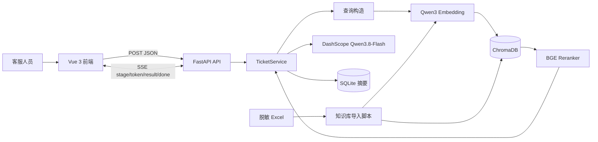
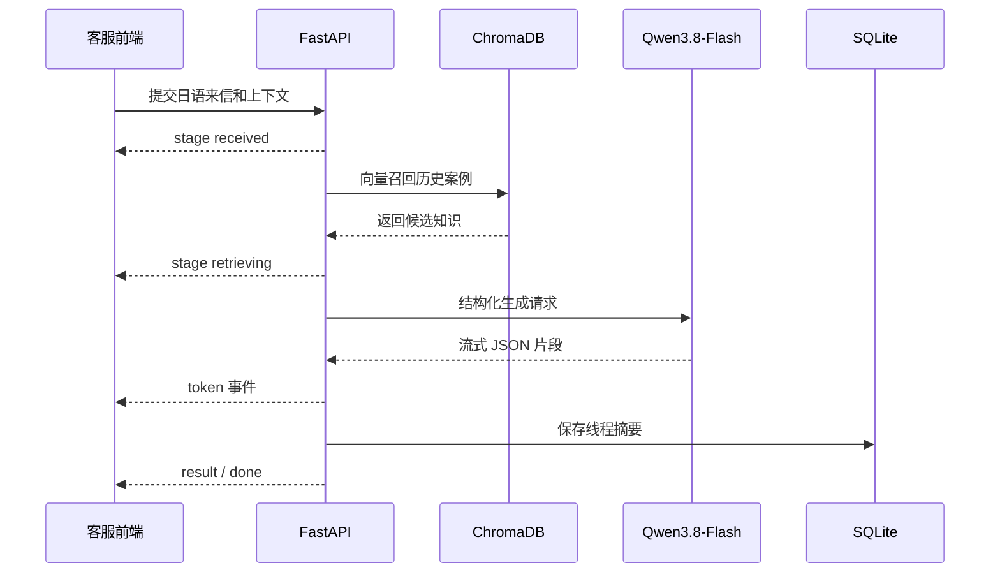

# 日本游戏客服智能化系统

[](#当前边界)
[](https://www.python.org/)
[](https://fastapi.tiangolo.com/)
[](https://vuejs.org/)
[](https://www.trychroma.com/)
[](#许可证)

面向日本发行游戏的客服辅助系统。系统将日语玩家来信与历史客服案例建立检索关联，生成中文处理建议和日语回复草稿，并通过风险标记、质量提醒和人工审核降低跨语言、跨文化客服处理成本。

> 当前版本是客服辅助 MVP。系统不会自动执行退款、补偿、封禁、账号恢复或其他后台操作，所有回复默认需要人工审核。

## 核心特性

- **日语客服辅助**：基于玩家来信生成中文处理建议和日语回复草稿。
- **检索增强生成**：使用 ChromaDB 保存历史客服案例、政策和术语知识，并将检索结果提供给模型。
- **多模型协作**：Qwen3-Embedding-0.6B 负责向量化，BGE-Reranker-v2-m3 负责重排，Qwen3.8-Flash 负责结构化生成。
- **风险与质量字段**：输出意图、风险等级、缺失信息和质量提醒，支持人工审核和升级处理。
- **SSE 流式输出**：实时推送接收、检索、生成、校验、结果和完成事件。
- **知识库导入**：从脱敏 Excel 工作簿导入客服线程，并按 `support_cases`、`policies`、`terminology` 集合组织数据。
- **基础记忆能力**：当前 MVP 使用 SQLite 保存线程摘要；Redis、PostgreSQL 用户画像和长期记忆属于后续演进方向。
- **独立回归测试**：黄金测试集、后端测试和前端构建可通过一条命令执行。

## 系统架构



### 在线处理流程



## 技术栈

| 层级 | 技术 | 用途 |
| --- | --- | --- |
| 前端 | Vue 3、Vite | 客服工作台和 SSE 结果展示 |
| API | FastAPI、Uvicorn | REST API、SSE 和 CORS |
| 编排 | Python Service Layer | 检索、模型、记忆和业务流程编排 |
| 向量库 | ChromaDB 0.6.3 | 本地持久化向量集合 |
| Embedding | Qwen/Qwen3-Embedding-0.6B | 日中多语言文本向量化 |
| 重排 | BAAI/bge-reranker-v2-m3 | 检索候选重排 |
| 生成模型 | DashScope OpenAI-compatible API、Qwen3.8-Flash | 中文建议、日语回复和结构化判断 |
| 本地状态 | SQLite | MVP 阶段的线程摘要和导入记录 |
| 数据处理 | openpyxl | 脱敏 Excel 解析和知识库导入 |
| 测试 | pytest、Vite build | 后端回归、黄金集契约和前端构建 |

## 快速开始

### 环境要求

- Windows、macOS 或 Linux
- Python 3.12+
- Node.js 18+
- 可用的 DashScope API Key
- 首次运行需要下载本地 Embedding 和 Reranker 模型

### 1. 安装后端依赖

```bash
python -m venv .venv

# Windows PowerShell
.venv\Scripts\Activate.ps1

# macOS / Linux
# source .venv/bin/activate

python -m pip install -r requirements.txt
```

### 2. 配置环境变量

```powershell
copy .env.example .env
```

编辑 `.env`，至少设置：

```dotenv
DASHSCOPE_API_KEY=你的DashScope_API_Key
```

确认 `SOURCE_XLSX_PATH` 指向脱敏数据文件，例如：

```dotenv
SOURCE_XLSX_PATH=D:/桌面/脱敏数据2026.2.10.xlsx
```

### 3. 启动服务

在第一个终端启动后端：

```powershell
.venv\Scripts\python.exe -m uvicorn app.main:app --app-dir backend --host 127.0.0.1 --port 8000 --reload
```

在第二个终端启动前端：

```powershell
cd frontend
npm install
npm run dev -- --host 127.0.0.1 --port 5173
```

打开：`http://127.0.0.1:5173/index.html`

## 模型和知识库初始化

### 下载本地模型

```powershell
.venv\Scripts\python.exe backend\scripts\download_models.py
```

模型默认缓存到 `backend/models/`，该目录已加入 `.gitignore`。

### 导入知识库

```powershell
.venv\Scripts\python.exe backend\scripts\ingest_knowledge.py
```

资源受限时可只导入部分线程：

```powershell
$env:INGEST_MAX_THREADS=64
.venv\Scripts\python.exe backend\scripts\ingest_knowledge.py
Remove-Item Env:INGEST_MAX_THREADS
```

完整导入时不要设置 `INGEST_MAX_THREADS`。如果本机无法承载 BGE-Reranker，可临时配置 `ENABLE_RERANKER=false`，生产环境不建议关闭。

## 配置说明

所有配置均可通过 `.env` 覆盖。

| 环境变量 | 默认值 | 说明 |
| --- | --- | --- |
| `DASHSCOPE_API_KEY` | 空 | DashScope API 密钥 |
| `DASHSCOPE_BASE_URL` | `https://dashscope.aliyuncs.com/compatible-mode/v1` | OpenAI-compatible API 地址 |
| `DASHSCOPE_MODEL` | `qwen3.8-flash` | 中文建议、日语回复和结构化判断模型 |
| `DATABASE_PATH` | `backend/data/customer_service.db` | SQLite 数据库路径 |
| `CHROMA_PATH` | `backend/chroma_data` | ChromaDB 持久化路径 |
| `SOURCE_XLSX_PATH` | `D:/桌面/脱敏数据2026.2.10.xlsx` | 原始脱敏 Excel 路径 |
| `EMBEDDING_MODEL` | `Qwen/Qwen3-Embedding-0.6B` | 本地向量模型 |
| `RERANKER_MODEL` | `BAAI/bge-reranker-v2-m3` | 本地重排模型 |
| `FRONTEND_ORIGIN` | `http://localhost:5173` | CORS 允许的前端来源 |
| `AUTO_LOAD_LOCAL_MODELS` | `false` | 是否自动加载本地模型配置 |
| `ENABLE_RERANKER` | `true` | 是否启用 BGE-Reranker |
| `INGEST_MAX_THREADS` | `0` | 导入时最多处理的线程数，`0` 表示不限制 |

## 使用示例

### 健康检查

```bash
curl.exe http://127.0.0.1:8000/api/health
```

### 查询知识库统计

```bash
curl.exe http://127.0.0.1:8000/api/knowledge/stats
```

### 普通 JSON 分析接口

```powershell
curl.exe -X POST http://127.0.0.1:8000/api/tickets/analyze `
  -H "Content-Type: application/json" `
  -d "{\"message\":\"アップデート後にログインできません。\",\"thread_id\":\"demo-001\",\"platform\":\"iOS\",\"app_version\":\"1.1.4\"}"
```

### SSE 流式分析接口

```powershell
curl.exe -N -X POST http://127.0.0.1:8000/api/tickets/analyze/stream `
  -H "Content-Type: application/json" `
  -d "{\"message\":\"アップデート後にログインできません。\",\"thread_id\":\"demo-001\",\"platform\":\"iOS\",\"app_version\":\"1.1.4\"}"
```

SSE 事件包括 `stage`、`token`、`result`、`done` 和 `error`。

### 结构化响应字段

```json
{
  "intent": "登录或账号问题",
  "risk_level": "medium",
  "missing_information": ["用户ID"],
  "chinese_guidance": "建议先核对账号标识和设备信息，再确认是否存在数据迁移问题。",
  "japanese_reply": "お問い合わせありがとうございます。まずはユーザーIDをご確認ください。",
  "quality_warnings": [],
  "retrieved_cases": []
}
```

## API 目录

| 方法 | 路径 | 用途 |
| --- | --- | --- |
| `GET` | `/api/health` | 服务健康检查 |
| `GET` | `/api/knowledge/stats` | 查看三个 ChromaDB 集合的记录数量 |
| `POST` | `/api/knowledge/ingest` | 导入配置中的脱敏 Excel 知识库 |
| `POST` | `/api/tickets/analyze` | 返回完整 JSON 分析结果 |
| `POST` | `/api/tickets/analyze/stream` | 通过 SSE 流式返回分析过程和结果 |

## 测试与质量门禁

```powershell
.venv\Scripts\python.exe golden_tests\run_all.py
```

该命令依次执行黄金测试集契约校验、后端全部 pytest 测试和前端 Vite 生产构建。通过标准是输出 `总体结果：通过` 且退出码为 `0`，详细报告位于 `golden_tests/reports/latest_report.md`。

每次新增或修改功能后，都必须重新运行全部测试。黄金测试集及测试策略见 [黄金测试集测试说明.md](黄金测试集测试说明.md)。默认回归测试不调用真实 Qwen API，以避免每次测试产生模型费用；真实模型质量评测应在完成人工金标准标注后单独执行。

## 项目结构

```text
.
├── backend/
│   ├── app/
│   │   ├── main.py                 # FastAPI 应用和路由
│   │   ├── config.py               # 环境变量和运行配置
│   │   ├── schemas.py              # 请求与响应模型
│   │   ├── repositories/           # SQLite 持久化
│   │   └── services/               # 模型、检索、导入和工单编排
│   ├── scripts/                    # 模型下载和知识库导入
│   └── tests/                      # 后端自动化测试
├── frontend/                       # Vue 3 + Vite 前端
├── golden_tests/                   # 独立黄金集测试入口
├── 黄金测试集_脱敏客服.xlsx          # 90 条脱敏黄金测试记录
├── 项目设计书.md
├── AGENTS.md
├── .env.example
└── requirements.txt
```

## 当前边界与安全说明

- 历史客服资料默认只作为参考知识，不代表当前政策自动生效。
- 模型输出不能直接执行退款、补偿、封禁、账号恢复或其他后台操作。
- 高风险问题应由人工客服复核后再发送。
- 不要将 `.env`、API Key、用户数据、数据库、ChromaDB 数据、模型缓存或敏感日志提交到 Git。
- 生产部署前应补充认证、授权、审计日志、限流、密钥托管、数据保留周期和多租户隔离策略。
- 当前 SQLite 仅适用于开发和小规模验证；生产环境应按项目设计书演进到 PostgreSQL，并补充 Redis 窗口记忆和长期记忆访问控制。

## 贡献指南

1. 每次功能改动都创建独立 Git commit，保持提交主题清晰。
2. 每次改动都补充或更新相关测试。
3. 提交前执行完整回归命令，并确认报告为通过。
4. 不提交密钥、用户数据、模型缓存、数据库文件和本地 ChromaDB 数据。
5. 复杂业务规则需要在代码、测试或项目设计书中留下可追溯说明。

建议提交主题格式：

```text
feat: add a new capability
fix: correct an existing behavior
test: improve regression coverage
docs: update project documentation
chore: update tooling or configuration
```

## 许可证

当前仓库尚未包含 `LICENSE` 文件。

`[TODO: 选择适用的开源许可证并在项目根目录添加 LICENSE 文件，例如 Apache-2.0、MIT 或 GPL-3.0。]`
